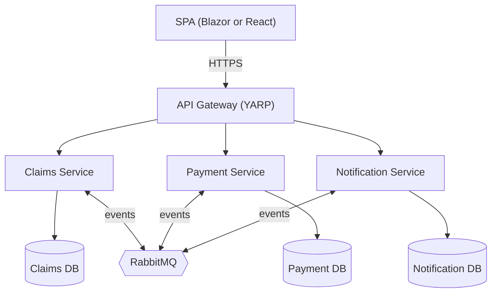
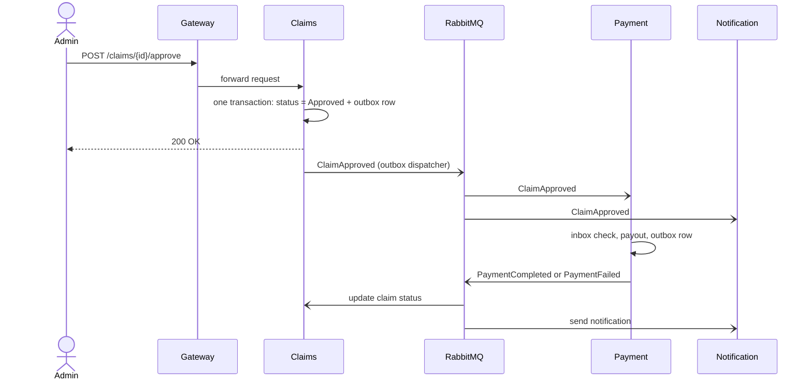
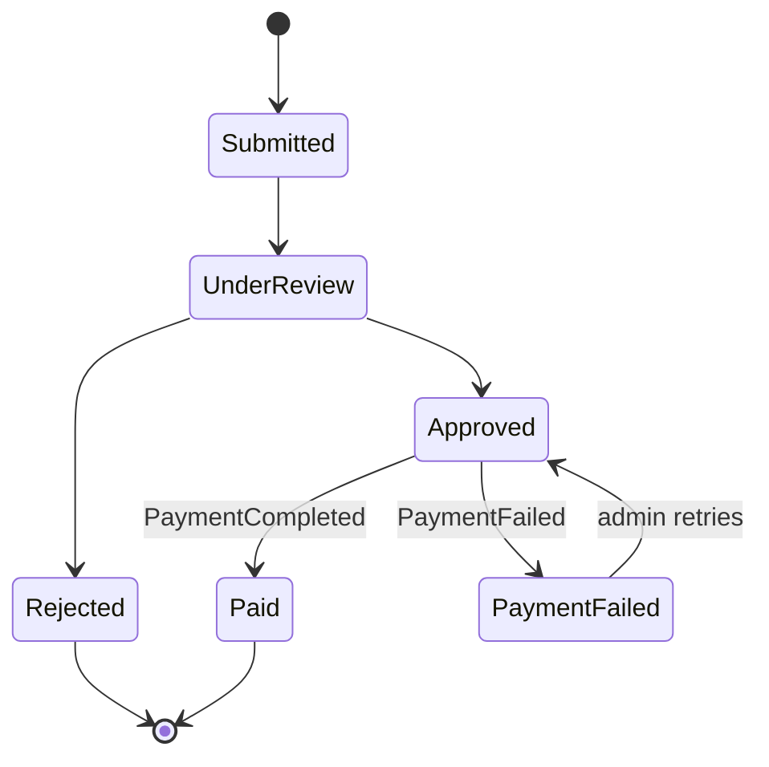

# Insurance Claims System

Three small .NET services that never call each other directly. They react to events through RabbitMQ and use the **Outbox** and **Inbox** patterns, so a payment is never lost or processed twice.

> **Status:** [ Developing ] . See the [roadmap](#roadmap).

## Features (MVP)

- Submit a claim (claimant)
- Approve or reject a claim (admin)
- Automatic payout after approval
- Claim status tracking
- Notification log (what was sent, to whom, when)
- JWT auth with two roles: `Claimant`, `Admin`

**Faked behind interfaces** (swap later, Application layer unchanged):

- Payment provider: `IPaymentProvider` with a fake implementation
- Email/SMS: `INotificationSender` with a stub that writes to the DB/log

**Out of scope:** Kubernetes, distributed tracing stack, full identity provider, document uploads, real payment integration.

## Architecture



**Rules**

- The SPA talks only to the gateway.
- Services never call each other over HTTP. Service-to-service communication is events only.
- Each service owns its database. No cross-service joins, no shared tables.

### Services

| Service | Responsibility | Publishes | Consumes |
|---|---|---|---|
| Claims | Claim lifecycle, approve/reject, status | `ClaimSubmitted`, `ClaimApproved`, `ClaimRejected` | `PaymentCompleted`, `PaymentFailed` |
| Payment | Payout after approval, payment records | `PaymentCompleted`, `PaymentFailed` | `ClaimApproved` |
| Notification | Send and log notifications | none | all claim and payment events |
| Gateway | Routing, JWT validation | none | none |

### API (MVP)

- **Claims:** `POST /claims`, `GET /claims`, `GET /claims/{id}`, `POST /claims/{id}/approve`, `POST /claims/{id}/reject`
- **Payment:** `GET /payments?claimId=`
- **Notification:** `GET /notifications?claimId=`

### Events

| Event | Published by | Consumed by |
|---|---|---|
| `ClaimSubmitted` | Claims | Notification |
| `ClaimApproved` | Claims | Payment, Notification |
| `ClaimRejected` | Claims | Notification |
| `PaymentCompleted` | Payment | Claims, Notification |
| `PaymentFailed` | Payment | Claims, Notification |

Every event carries `EventId` (used for idempotency), `CorrelationId` (the claim flow), `OccurredAt`, and the payload. Contracts live in a small shared `Contracts` library, so keep events additive (never rename or remove fields).

## Claim approval flow



### Claim state machine



Transitions live inside the `Claim` aggregate (Domain layer) and throw on illegal moves.

## Patterns

- **Saga (choreography):** no central orchestrator. Each service reacts to events and emits the next one.
- **Outbox (publisher side):** the state change and an `OutboxMessage` row are saved in the same DB transaction. A background dispatcher publishes unsent rows. This avoids "claim saved but event lost".
- **Inbox / idempotency (consumer side):** RabbitMQ delivers at least once, so consumers store processed `EventId`s behind a unique index and skip duplicates. This prevents double payouts.
- **Failure handling:** retry with delay on transient failures, dead-letter queue for poison messages, a `BackgroundService` for the outbox dispatcher, Hangfire for stuck-claim reminders and payment retry.

## Clean Architecture (per service)

Dependencies point inward only.

```
Domain  ←  Application  ←  Infrastructure
                ↑                ↑
                └──────  Api  ───┘
```

| Layer | Contains | Must NOT reference |
|---|---|---|
| `Domain` | Entities, value objects, domain events, domain rules | anything |
| `Application` | Use cases (MediatR), interfaces, DTOs, validators | EF Core, RabbitMQ, Hangfire |
| `Infrastructure` | EF Core, repositories, outbox/inbox, RabbitMQ, Hangfire jobs, fake provider | Api |
| `Api` | Endpoints, DI composition root, auth, middleware | business logic |

## Solution structure

```
InsurancePlatform/
├── InsurancePlatform.sln
├── docker-compose.yml
├── docs/                      # plan, diagrams, ADRs
├── src/
│   ├── BuildingBlocks/
│   │   └── Contracts/         # shared event contracts
│   ├── Gateway/
│   │   └── Gateway.Api/       # YARP + JWT validation
│   ├── Services/
│   │   ├── Claims/            # Domain, Application, Infrastructure, Api
│   │   ├── Payment/           # Domain, Application, Infrastructure, Api
│   │   └── Notification/      # Domain, Application, Infrastructure, Api
│   └── Web/                   # Blazor WASM or React app
└── tests/
    ├── Claims.Domain.Tests/
    ├── Claims.Application.Tests/
    └── Claims.IntegrationTests/   # Testcontainers: Postgres + RabbitMQ
```

## Tech stack

- .NET, ASP.NET Core minimal APIs, MediatR, EF Core
- PostgreSQL (one container, three separate databases)
- RabbitMQ (with management UI)
- YARP gateway, JWT auth
- Hangfire for scheduled jobs (reminders, payment retry); the outbox dispatcher is a plain `BackgroundService`
- Docker Compose, Testcontainers

## Key decisions

| ADR | Decision |
|---|---|
| 1 | **RabbitMQ over Kafka.** Workflow-style messaging with built-in ack/retry/DLQ and low volume. Kafka would win for replay, event sourcing or very high throughput. The broker sits behind `IEventPublisher`, so switching is cheap. |
| 2 | **Frontend: Blazor WASM vs React.** Open. Decide before Phase 6. The gateway API is identical for both. |
| 3 | **PostgreSQL**, one container with three logically separate databases. No cross-database queries. |
| 4 | **Messaging library** open (MassTransit, Wolverine, raw `RabbitMQ.Client`). Check MassTransit's licensing first. Outbox/Inbox will be implemented manually first. |
| 5 | **Choreography over orchestration.** Three services, linear flow. Revisit if the flow grows branches. |

## Getting started

> Not runnable yet. This section will be filled in as Phase 0 and Phase 7 land.

```bash
cp .env.example .env
docker compose up --build
```

Every service will expose `/health`. Configuration comes from environment variables.

## Roadmap

- **Phase 0: Foundation.** Repo, solution structure, `docker-compose.yml` with RabbitMQ + PostgreSQL, `Contracts` project with the 5 events
- **Phase 1: Claims service** (no messaging). Domain + unit tests, use cases, EF Core, endpoints
- **Phase 2: Outbox + first event.** `OutboxMessage` in the same transaction, `BackgroundService` dispatcher publishes the claim events
- **Phase 3: Payment service.** Consume `ClaimApproved`, inbox for idempotency, fake provider, publish result via outbox
- **Phase 4: Close the loop + Notification.** Claims consumes payment result, Notification logs everything
- **Phase 5: Gateway + auth.** YARP routes, JWT, `Claimant` / `Admin` roles
- **Phase 6: Frontend.** Submit claim, list/detail, admin approve/reject, notifications view
- **Phase 7: Deploy.** Dockerfiles, compose end to end, public URL
- **Phase 8: Hardening.** Retry + DLQ, correlation IDs in logs, Testcontainers integration tests, stuck-claim reminder job